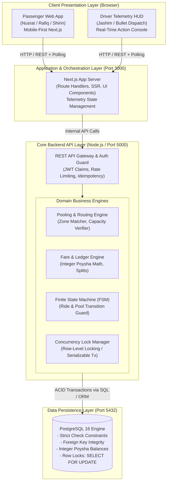

# Module 02: System Architecture, Data Model & ERD

**Project:** Dhaka Tesla Pool  
**Author:** Software Architect & Principal Engineer  
**Document Classification:** Core Technical Architecture Document  

---

## 1. High-Level Architecture Overview

The system follows a clean, decoupled three-tier architectural model designed for high predictability, zero-drift state synchronization, and rapid local execution via Docker. 

### System Topology Diagram



---

## 2. Technology Choices & Architectural Justification (PRD §6 & §7)

| Component | Selected Technology | Evaluated Alternatives | Rationale for Ride-Pooling MVP | What Would Trigger a Switch Later? |
|---|---|---|---|---|
| **Frontend** | **Next.js (App Router, TypeScript)** | Plain React (Vite), SvelteKit, Remix | Single framework delivering server-rendered landing performance, unified API routing, zero-bundle overhead for static layouts, and strong TypeScript typings. | If team size scales past 50 engineers needing fully decoupled micro-frontends with custom Webpack federations. |
| **Backend** | **Node.js with Fastify / Express** | NestJS, Go (Gin), Python (FastAPI) | Lightweight, non-blocking asynchronous event loop ideal for I/O-bound booking queries. Avoids NestJS class-heavy boilerplate overhead while maintaining pristine modularity. | If booking throughput exceeds 50,000 requests/sec with heavy CPU-bound graph route optimization, migrating core matching to Go or Rust. |
| **Database** | **PostgreSQL 16** | MongoDB, MySQL, SQLite | ACID guarantees, native `SELECT ... FOR UPDATE` row-level pessimistic locking for the last-seat race condition, robust check constraints, and future PostGIS compatibility. | If read-heavy geospatial searches across millions of moving vehicles require distributed memory caches (Redis) or Cassandra for raw telemetry. |
| **Data Access** | **Prisma / Kysely (Type-Safe Query Builder)** | TypeORM, Raw pg-node | Zero runtime overhead with compile-time type safety; explicit transaction control without hidden magic or uncontrolled query cascades. | If microsecond query compilation demands pre-compiled prepared raw SQL queries. |
| **Styling** | **Vanilla CSS & Tailwind Utility Tokens** | CSS Modules, Styled Components, Material UI | Maximum control over 90 FPS rendering without runtime CSS-in-JS injection stutter. Enables strict functional semantic color palettes. | If design requires platform-agnostic cross-compilation to React Native / Flutter. |
| **Container** | **Docker Compose** | Kubernetes, Nomad, Bare VM | Instant reproducible developer setup in one command (`docker compose up`). Completely satisfies challenge requirement without paid infrastructure. | Cloud deployment to managed ECS/Fargate or Kubernetes when auto-scaling across multiple cloud zones is required. |

---

## 3. Entity-Relationship Diagram (ERD)

The database schema is modeled strictly in Third Normal Form (3NF) to guarantee referential integrity, eliminate duplicate billing states, and preserve immutable audit histories.

```mermaid
erDiagram
    USERS ||--o{ VEHICLES : "owns / drives"
    USERS ||--o{ RIDE_REQUESTS : "requests"
    USERS ||--o{ WALLETS : "has"
    VEHICLES ||--o{ POOLS : "assigned to"
    POOLS ||--o{ POOL_MEMBERSHIPS : "contains"
    RIDE_REQUESTS ||--o| POOL_MEMBERSHIPS : "fulfills"
    WALLETS ||--o{ WALLET_TRANSACTIONS : "logs"
    RIDE_REQUESTS ||--o{ AUDIT_EVENTS : "tracks"
    POOLS ||--o{ AUDIT_EVENTS : "tracks"

    USERS {
        uuid id PK
        string full_name "e.g. Jashim, Nusrat, Rafiq, Shirin"
        string email UK
        string password_hash
        string phone
        string role "DRIVER | PASSENGER | ADMIN"
        timestamp created_at
    }

    VEHICLES {
        uuid id PK
        uuid driver_id FK "References USERS(id)"
        string name "e.g. Bullet"
        string model "Dhaka Electric Tesla (3-Wheeler)"
        string license_plate UK
        int capacity "3 seats (Fixed)"
        boolean is_active
        timestamp created_at
    }

    POOLS {
        uuid id PK
        uuid vehicle_id FK "References VEHICLES(id)"
        uuid driver_id FK "References USERS(id)"
        string current_zone "e.g. Banani"
        string destination_zone "e.g. Mohakhali / Gulshan 1"
        int max_capacity "3"
        int occupied_seats "Default 0, max 3"
        string status "OPEN | DISPATCHED | IN_TRANSIT | CLOSED"
        timestamp created_at
        timestamp updated_at
    }

    RIDE_REQUESTS {
        uuid id PK
        uuid passenger_id FK "References USERS(id)"
        string pickup_zone "e.g. Banani"
        string destination_zone "e.g. Mohakhali"
        int requested_seats "1 to 3"
        bigint base_fare_poysha "Integer Poysha"
        bigint distance_fare_poysha "Integer Poysha"
        bigint discount_poysha "Integer Poysha"
        bigint total_fare_poysha "Integer Poysha"
        string status "REQUESTED | MATCHED | DRIVER_ARRIVED | STARTED | COMPLETED | CANCELLED"
        string idempotency_key UK
        timestamp created_at
        timestamp updated_at
    }

    POOL_MEMBERSHIPS {
        uuid id PK
        uuid pool_id FK "References POOLS(id)"
        uuid ride_request_id FK "References RIDE_REQUESTS(id)"
        uuid passenger_id FK "References USERS(id)"
        int seats_allocated "1 to 3"
        bigint fare_charged_poysha "Integer Poysha"
        timestamp joined_at
        timestamp dropped_at
    }

    WALLETS {
        uuid id PK
        uuid user_id FK UK "References USERS(id)"
        bigint balance_poysha "Default 100000 (৳1,000.00)"
        string currency "BDT"
        timestamp updated_at
    }

    WALLET_TRANSACTIONS {
        uuid id PK
        uuid wallet_id FK "References WALLETS(id)"
        uuid ride_request_id FK "Optional reference"
        bigint amount_poysha "Signed (+ for credit, - for debit)"
        string transaction_type "DEPOSIT | RIDE_PAYMENT | DRIVER_PAYOUT"
        string description
        timestamp created_at
    }

    AUDIT_EVENTS {
        uuid id PK
        string entity_name "RIDE_REQUEST | POOL | WALLET"
        uuid entity_id
        uuid actor_id FK "References USERS(id)"
        string event_type "STATE_CHANGE | CAPACITY_LOCK | FARE_SPLIT"
        string previous_state
        string new_state
        jsonb metadata
        timestamp created_at
    }
```

---

## 4. Production PostgreSQL DDL Schema

```sql
-- Enforce UUID Extension
CREATE EXTENSION IF NOT EXISTS "uuid-ossp";

-- 1. Users Table
CREATE TABLE users (
    id UUID PRIMARY KEY DEFAULT uuid_generate_v4(),
    full_name VARCHAR(100) NOT NULL,
    email VARCHAR(150) UNIQUE NOT NULL,
    password_hash VARCHAR(255) NOT NULL,
    phone VARCHAR(20) NOT NULL,
    role VARCHAR(20) NOT NULL CHECK (role IN ('PASSENGER', 'DRIVER', 'ADMIN')),
    created_at TIMESTAMPTZ NOT NULL DEFAULT NOW()
);

-- 2. Vehicles Table
CREATE TABLE vehicles (
    id UUID PRIMARY KEY DEFAULT uuid_generate_v4(),
    driver_id UUID NOT NULL REFERENCES users(id) ON DELETE CASCADE,
    name VARCHAR(50) NOT NULL DEFAULT 'Bullet',
    model VARCHAR(100) NOT NULL DEFAULT 'Electric Rickshaw Tesla',
    license_plate VARCHAR(50) UNIQUE NOT NULL,
    capacity INT NOT NULL DEFAULT 3 CHECK (capacity > 0 AND capacity <= 6),
    is_active BOOLEAN NOT NULL DEFAULT TRUE,
    created_at TIMESTAMPTZ NOT NULL DEFAULT NOW()
);

-- 3. Pools Table (Represents a shared vehicle dispatch session)
CREATE TABLE pools (
    id UUID PRIMARY KEY DEFAULT uuid_generate_v4(),
    vehicle_id UUID NOT NULL REFERENCES vehicles(id),
    driver_id UUID NOT NULL REFERENCES users(id),
    current_zone VARCHAR(50) NOT NULL,
    destination_zone VARCHAR(50),
    max_capacity INT NOT NULL DEFAULT 3,
    occupied_seats INT NOT NULL DEFAULT 0,
    status VARCHAR(20) NOT NULL DEFAULT 'OPEN' CHECK (status IN ('OPEN', 'DISPATCHED', 'IN_TRANSIT', 'CLOSED')),
    created_at TIMESTAMPTZ NOT NULL DEFAULT NOW(),
    updated_at TIMESTAMPTZ NOT NULL DEFAULT NOW(),
    CONSTRAINT chk_pool_capacity CHECK (occupied_seats >= 0 AND occupied_seats <= max_capacity)
);

-- 4. Ride Requests Table
CREATE TABLE ride_requests (
    id UUID PRIMARY KEY DEFAULT uuid_generate_v4(),
    passenger_id UUID NOT NULL REFERENCES users(id),
    pickup_zone VARCHAR(50) NOT NULL,
    destination_zone VARCHAR(50) NOT NULL,
    requested_seats INT NOT NULL DEFAULT 1 CHECK (requested_seats >= 1 AND requested_seats <= 3),
    base_fare_poysha BIGINT NOT NULL DEFAULT 3000, -- ৳30.00
    distance_fare_poysha BIGINT NOT NULL DEFAULT 0,
    discount_poysha BIGINT NOT NULL DEFAULT 0,
    total_fare_poysha BIGINT NOT NULL DEFAULT 3000,
    status VARCHAR(25) NOT NULL DEFAULT 'REQUESTED' CHECK (
        status IN ('REQUESTED', 'MATCHED', 'DRIVER_ARRIVED', 'STARTED', 'COMPLETED', 'CANCELLED')
    ),
    idempotency_key VARCHAR(100) UNIQUE,
    created_at TIMESTAMPTZ NOT NULL DEFAULT NOW(),
    updated_at TIMESTAMPTZ NOT NULL DEFAULT NOW()
);

-- 5. Pool Memberships Table (Mapping Many-to-One: Requests to Pool)
CREATE TABLE pool_memberships (
    id UUID PRIMARY KEY DEFAULT uuid_generate_v4(),
    pool_id UUID NOT NULL REFERENCES pools(id) ON DELETE CASCADE,
    ride_request_id UUID NOT NULL UNIQUE REFERENCES ride_requests(id) ON DELETE CASCADE,
    passenger_id UUID NOT NULL REFERENCES users(id),
    seats_allocated INT NOT NULL CHECK (seats_allocated >= 1 AND seats_allocated <= 3),
    fare_charged_poysha BIGINT NOT NULL,
    joined_at TIMESTAMPTZ NOT NULL DEFAULT NOW(),
    dropped_at TIMESTAMPTZ
);

-- 6. Wallets Table (Simulated TeslaPay)
CREATE TABLE wallets (
    id UUID PRIMARY KEY DEFAULT uuid_generate_v4(),
    user_id UUID NOT NULL UNIQUE REFERENCES users(id) ON DELETE CASCADE,
    balance_poysha BIGINT NOT NULL DEFAULT 100000 CHECK (balance_poysha >= 0), -- ৳1,000.00 initial
    currency VARCHAR(10) NOT NULL DEFAULT 'BDT',
    updated_at TIMESTAMPTZ NOT NULL DEFAULT NOW()
);

-- 7. Wallet Transactions (Immutable Ledger)
CREATE TABLE wallet_transactions (
    id UUID PRIMARY KEY DEFAULT uuid_generate_v4(),
    wallet_id UUID NOT NULL REFERENCES wallets(id) ON DELETE CASCADE,
    ride_request_id UUID REFERENCES ride_requests(id),
    amount_poysha BIGINT NOT NULL, -- Negative for debit, positive for credit
    transaction_type VARCHAR(30) NOT NULL CHECK (transaction_type IN ('DEPOSIT', 'HOLD', 'RIDE_PAYMENT', 'REFUND', 'DRIVER_PAYOUT')),
    description TEXT NOT NULL,
    created_at TIMESTAMPTZ NOT NULL DEFAULT NOW()
);

-- 8. Immutable Audit Events Table
CREATE TABLE audit_events (
    id UUID PRIMARY KEY DEFAULT uuid_generate_v4(),
    entity_name VARCHAR(50) NOT NULL,
    entity_id UUID NOT NULL,
    actor_id UUID REFERENCES users(id),
    event_type VARCHAR(50) NOT NULL,
    previous_state VARCHAR(50),
    new_state VARCHAR(50),
    metadata JSONB,
    created_at TIMESTAMPTZ NOT NULL DEFAULT NOW()
);

-- High Performance Indexes
CREATE INDEX idx_ride_requests_status ON ride_requests(status);
CREATE INDEX idx_ride_requests_passenger ON ride_requests(passenger_id);
CREATE INDEX idx_pools_driver_status ON pools(driver_id, status);
CREATE INDEX idx_pools_pickup_zone ON pools(current_zone, status);
CREATE INDEX idx_pool_memberships_pool_id ON pool_memberships(pool_id);
```

---

## 5. Currency & Fare Mathematics (PRD §5)

### Why Integer Poysha (Paisa) Instead of Decimals?
Computers represent fractional numbers using standard IEEE-754 binary floating-point representation. Under this system, base-10 fractions like `0.1` and `0.2` cannot be represented with exact precision in base-2 binary:
```javascript
// Floating point flaw:
0.1 + 0.2 === 0.30000000000000004 // TRUE
```
In a financial transaction system:
- Successive fractional fare splits accumulate rounding errors.
- Ledger audits drift over time.
- Security vulnerabilities arise when pennies/poysha disappear or duplicate.

**Our Architecture Invariant:**  
All currency calculations, balances, discounts, and payments are stored and computed strictly as **64-bit signed integers in Poysha** (`1 BDT = 100 Poysha`). Decimals are introduced purely at the final UI formatting layer:
$$\text{Display Fare} = \frac{\text{fare\_poysha}}{100} \text{ BDT}$$

### Fare Model Formula & Hand-Calculated Verification
The PRD mandates the testable formula:
$$\text{passengerFare} = \text{baseFare} + \text{distanceCharge} - \text{poolDiscount}$$

#### Standard Pricing Parameters
- **Base Fare ($\text{baseFare}$):** ৳30.00 = `3000 poysha`
- **Rate per Kilometer ($\text{ratePerKm}$):** ৳15.00 / km = `1500 poysha/km`
- **Pooling Discount ($\text{poolDiscount}$):** 25% discount off total fare when matched with at least 1 co-passenger (`0.25`).

---

### Hand Calculation Example: Nusrat & Rafiq

#### Scenario 1: Nusrat Books Solo
- **Route:** Banani Road 11 $\rightarrow$ Mohakhali
- **Distance:** 3.0 km
- **Base Fare:** ৳30.00 (`3000 poysha`)
- **Distance Charge:** $3.0 \times ৳15.00 = ৳45.00$ (`4500 poysha`)
- **Solo Total (No Pool):**
  $$\text{Solo Fare} = 3000 + 4500 - 0 = \mathbf{7500 \text{ poysha}} \ (\text{৳}75.00)$$

#### Scenario 2: Rafiq Books Solo
- **Route:** Banani Road 11 $\rightarrow$ Gulshan 1
- **Distance:** 2.5 km
- **Base Fare:** ৳30.00 (`3000 poysha`)
- **Distance Charge:** $2.5 \times ৳15.00 = ৳37.50$ (`3750 poysha`)
- **Solo Total (No Pool):**
  $$\text{Solo Fare} = 3000 + 3750 - 0 = \mathbf{6750 \text{ poysha}} \ (\text{৳}67.50)$$

#### Scenario 3: Jashim Matches Both in "Bullet" (Pool Activated!)
Once Jashim's pool bundles Nusrat and Rafiq together, the **25% Pooling Discount** is applied to both passenger tickets:

- **Nusrat's Discounted Pool Fare:**
  $$\text{Discount} = \lfloor 7500 \times 0.25 \rfloor = 1875 \text{ poysha} \ (\text{৳}18.75)$$
  $$\text{Nusrat Final Fare} = 7500 - 1875 = \mathbf{5625 \text{ poysha}} \ (\mathbf{\text{৳}56.25})$$

- **Rafiq's Discounted Pool Fare:**
  $$\text{Discount} = \lfloor 6750 \times 0.25 \rfloor = 1687 \text{ poysha} \ (\text{৳}16.87)$$
  $$\text{Rafiq Final Fare} = 6750 - 1687 = \mathbf{5063 \text{ poysha}} \ (\mathbf{\text{৳}50.63})$$

- **Driver (Jashim) Total Earnings:**
  $$\text{Jashim Gross} = 5625 + 5063 = \mathbf{10688 \text{ poysha}} \ (\mathbf{\text{৳}106.88})$$

*Observation:* Both passengers save 25%, while Jashim earns ৳106.88 instead of ৳75.00 for a single trip. The pooling economics work perfectly in integer poysha without a single lost fraction.

---

## 6. Predefined Dhaka Geography & Zone Matrix (PRD §4)

To keep geography simple and avoid brittle external map API dependencies, the system uses a fixed topological zone map:

| Zone ID | Zone Name | Zone Coordinates (Lat, Lng) | Compatible Southbound Routes | Compatible Northbound Routes |
|---|---|---|---|---|
| `Z_BAN` | **Banani** | `(23.7937, 90.4066)` | Mohakhali, Gulshan 1, Farmgate, Dhanmondi | Uttara, Mirpur, Bashundhara |
| `Z_GUL1` | **Gulshan 1** | `(23.7785, 90.4184)` | Mohakhali, Farmgate, Badda | Banani, Gulshan 2, Bashundhara |
| `Z_GUL2` | **Gulshan 2** | `(23.7949, 90.4143)` | Gulshan 1, Mohakhali | Baridhara, Bashundhara |
| `Z_MOH` | **Mohakhali** | `(23.7776, 90.4054)` | Farmgate, Dhanmondi | Banani, Uttara |
| `Z_FAR` | **Farmgate** | `(23.7570, 90.3896)` | Dhanmondi, Shahbagh | Mohakhali, Banani |
| `Z_DHA` | **Dhanmondi** | `(23.7465, 90.3760)` | Lalbagh, New Market | Farmgate, Banani |
| `Z_MIR` | **Mirpur 10** | `(23.8069, 90.3687)` | Farmgate, Agargaon | Uttara |
| `Z_UTT` | **Uttara** | `(23.8759, 90.3795)` | Airport, Banani | Gazipur |
| `Z_BAS` | **Bashundhara** | `(23.8191, 90.4326)` | Baridhara, Gulshan 2, Banani | Airport, Kuril |

### Zone Distance Matrix (in Kilometers)
```
          BAN    GUL1   GUL2   MOH    FAR    DHA    MIR    UTT    BAS
BAN     [ 0.0,   2.5,   1.5,   3.0,   5.5,   8.0,   7.0,   9.5,   4.2 ]
GUL1    [ 2.5,   0.0,   1.8,   2.2,   5.0,   7.5,   8.5,  11.0,   5.0 ]
GUL2    [ 1.5,   1.8,   0.0,   3.5,   6.0,   8.5,   8.0,  10.0,   3.2 ]
MOH     [ 3.0,   2.2,   3.5,   0.0,   3.2,   5.8,   6.5,  12.0,   6.5 ]
FAR     [ 5.5,   5.0,   6.0,   3.2,   0.0,   3.5,   6.0,  14.0,   8.5 ]
DHA     [ 8.0,   7.5,   8.5,   5.8,   3.5,   0.0,   8.0,  16.5,  11.0 ]
MIR     [ 7.0,   8.5,   8.0,   6.5,   6.0,   8.0,   0.0,   8.5,   9.0 ]
UTT     [ 9.5,  11.0,  10.0,  12.0,  14.0,  16.5,   8.5,   0.0,   6.0 ]
BAS     [ 4.2,   5.0,   3.2,   6.5,   8.5,  11.0,   9.0,   6.0,   0.0 ]
```

### Matching Rule Algorithm
1. **Pickup Proximity Check:** $\text{Distance}(\text{Req}_A.\text{pickup}, \text{Req}_B.\text{pickup}) \le 1.5 \text{ km}$ (e.g. Both at Banani).
2. **Directional Vector Compatibility:** Both trips share a destination in the same directional corridor (e.g. Southbound: Mohakhali $\approx 180^\circ$, Gulshan 1 $\approx 150^\circ$; Vector delta $< 45^\circ$).
3. **Cumulative Capacity Check:** $\sum \text{Seats Allocated} + \text{Incoming Seats} \le 3$.

