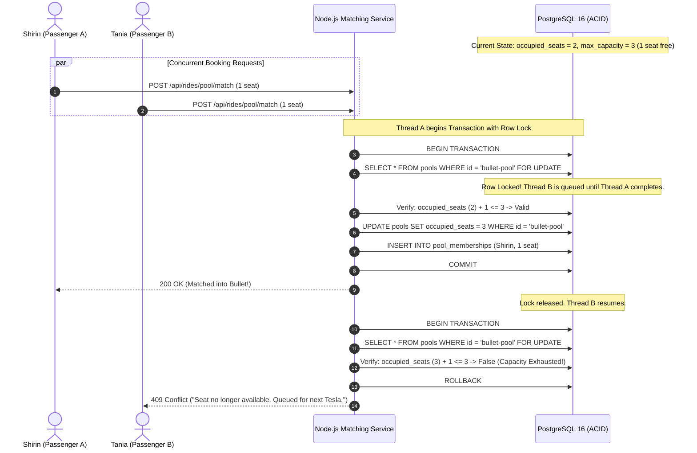
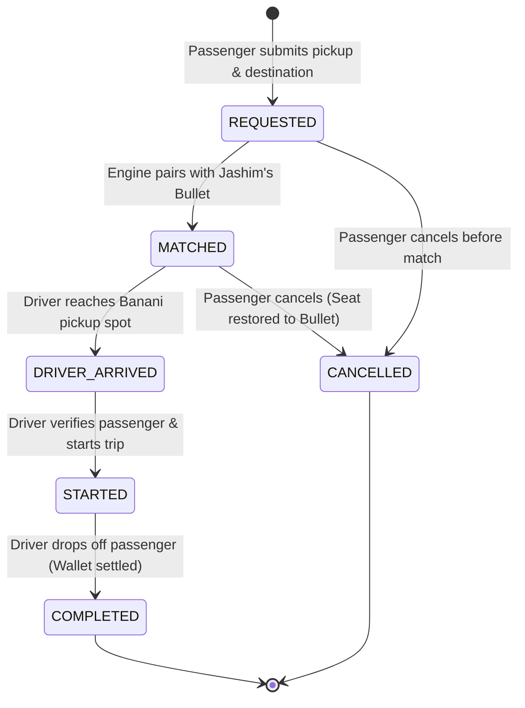

# Module 03: Concurrency Engine, State Machine & Security Architecture

**Project:** Dhaka Tesla Pool  
**Author:** Software Architect & Principal Engineer  
**Focus:** Race Condition Elimination, FSM Guardrails, and Zero-Trust Tenant Isolation  

---

## 1. The Concurrency Problem (PRD §12 & §14)

### The Failure Scenario: The Last-Seat Race
- **Context:** Jashim's "Bullet" has a fixed physical capacity of **3 seats**.
- **State:** 2 seats are already occupied (Nusrat has 1 seat, Rafiq has 1 seat). **Exactly 1 seat remains available.**
- **Event:** At $t_0$, **Shirin** requests the 1 remaining seat. Simultaneously at $t_0 + 5\text{ms}$, another passenger (e.g. **Tania**) requests the same 1 remaining seat.
- **The Naive Failure ("Check-Then-Act"):**
  1. Thread A reads: `occupied_seats = 2`, `max_capacity = 3` $\rightarrow$ OK!
  2. Thread B reads: `occupied_seats = 2`, `max_capacity = 3` $\rightarrow$ OK!
  3. Thread A executes: `UPDATE pools SET occupied_seats = 3`.
  4. Thread B executes: `UPDATE pools SET occupied_seats = 4`.
  5. **Disaster:** Bullet now has 4 passengers assigned to a 3-seat vehicle. Jashim arrives, chaos ensues on Banani Road 11, and the physical safety invariant is violated.

---

## 2. Engineering Solutions & Trade-Off Analysis



### Solution Strategies Compared

| Strategy | Mechanism | Pros | Cons | Verdict for Dhaka Tesla MVP |
|---|---|---|---|---|
| **A. Pessimistic Row Locking (`SELECT FOR UPDATE`)** | Database locks the specific vehicle pool row during evaluation within an isolated transaction. | 100% deterministic; zero chance of overbooking; built directly into PostgreSQL. | Holds lock for a few milliseconds during transaction execution. | **RECOMMENDED & IMPLEMENTED**: Absolute data integrity; Bullet's capacity is inviolable. |
| **B. Atomic Conditional SQL Update** | `UPDATE pools SET occupied_seats = occupied_seats + 1 WHERE id = $id AND (occupied_seats + 1) <= 3 RETURNING *;` | Lockless in application code; extremely fast execution. | Cannot perform complex multi-step discount recalculations inside the atomic query. | **Secondary Safety Guard**: Configured as database Check Constraint (`chk_pool_capacity`). |
| **C. Optimistic Concurrency Control (OCC)** | Uses `version` integer column (`UPDATE ... WHERE version = $old_version`). | Excellent for low-contention read-heavy systems. | In high-density rush hour, transactions fail and require retry loops, increasing latency. | Rejected for MVP; pessimistic lock is cleaner and predictable. |
| **D. Distributed Redis Lock (Redlock)** | External distributed mutex key (`SET bullet:lock NX PX 2000`). | Decouples locking from the relational database. | Over-engineering for single DB instance; adds Redis dependency violating PRD §9. | Documented in Scale Bonus (§09), excluded from MVP. |

### Concrete Implementation Code

```typescript
// services/poolService.ts
export async function claimPoolSeat(poolId: string, rideRequestId: string, passengerId: string, seatsRequested: number) {
  return await db.transaction(async (tx) => {
    // 1. Acquire exclusive pessimistic row lock on the pool
    const pool = await tx.raw(
      `SELECT * FROM pools WHERE id = ? FOR UPDATE`,
      [poolId]
    );

    if (!pool) {
      throw new NotFoundError('Pool not found');
    }

    // 2. Validate strict seat capacity
    const availableSeats = pool.max_capacity - pool.occupied_seats;
    if (availableSeats < seatsRequested) {
      throw new CapacityExceededError(
        `Insufficient seats: requested ${seatsRequested}, available ${availableSeats}`
      );
    }

    // 3. Atomically increment occupied seats
    const newOccupancy = pool.occupied_seats + seatsRequested;
    await tx('pools')
      .where({ id: poolId })
      .update({
        occupied_seats: newOccupancy,
        updated_at: new Date()
      });

    // 4. Create pool membership record
    const membership = await tx('pool_memberships').insert({
      id: crypto.randomUUID(),
      pool_id: poolId,
      ride_request_id: rideRequestId,
      passenger_id: passengerId,
      seats_allocated: seatsRequested,
      fare_charged_poysha: pool.calculated_fare_poysha,
      joined_at: new Date()
    }).returning('*');

    // 5. Update ride request state to MATCHED
    await tx('ride_requests')
      .where({ id: rideRequestId })
      .update({
        status: 'MATCHED',
        updated_at: new Date()
      });

    return membership;
  });
}
```

---

## 3. Finite State Machine (FSM) Lifecycle (PRD §3)

### State Transition Diagram



### Comprehensive Transition Verification Matrix

| Current State | Target State | Permitted Actors | Pre-conditions & Invariants | Side Effects & Financial Impact |
|---|---|---|---|---|
| *None* | `REQUESTED` | `PASSENGER` | Valid pickup/drop zones; requested seats $1 \le s \le 3$; passenger has no active ride. | Creates `ride_requests` record; calculates baseline solo fare estimate. |
| `REQUESTED` | `MATCHED` | `SYSTEM` / `DRIVER` | Pool has $\ge s$ available seats; driver is online; route vectors match. | Acquires row lock; increments `occupied_seats`; applies 25% pool discount to all members. |
| `REQUESTED` | `CANCELLED` | `PASSENGER` | Cancellation requested while unmatched. | Status $\rightarrow$ `CANCELLED`; zero financial penalty. |
| `MATCHED` | `DRIVER_ARRIVED`| `DRIVER` (Jashim)| Driver's location reaches pickup zone. | Triggers passenger notification: "Jashim and Bullet have arrived on Banani Road 11." |
| `MATCHED` | `CANCELLED` | `PASSENGER` | Ride has not yet started. | Frees allocated seats in pool (`occupied_seats -= s`); recalculates remaining co-passengers' fares if pool dissolves. |
| `DRIVER_ARRIVED`| `STARTED` | `DRIVER` (Jashim)| All assigned passengers onboard or accounted for. | Status $\rightarrow$ `STARTED`; trip timer initiates; cancellation locked out. |
| `STARTED` | `COMPLETED` | `DRIVER` (Jashim)| Destination reached (Mohakhali / Gulshan 1). | Wallet debited in integer poysha; driver wallet credited; seats freed in pool. |
| `*Any other*` | `*Invalid*` | *Blocked* | Any transition not in table (e.g. `REQUESTED` $\rightarrow$ `COMPLETED`). | **HTTP 409 Conflict / 400 Bad Request**: Rejection logged to `audit_events`. |

---

## 4. Security Architecture & Zero-Trust Tenant Isolation

### 1. The Nusrat-Rafiq Privacy Rule (PRD §2)
The PRD states: **"Each passenger needs to see their own fare and their own status, not anyone else's."**

In a shared vehicle:
- Nusrat must NOT be able to view Rafiq's phone number, full name, pickup address, wallet balance, or fare.
- Rafiq must NOT be able to view Nusrat's fare or trip history.
- The driver (Jashim) sees operational manifests (First name, pickup point, drop-off point, seat count), but NOT the passengers' personal wallet balances.

### 2. Authorization & Insecure Direct Object Reference (IDOR) Guard

```typescript
// middleware/authGuard.ts
export function requireRideOwnership(req: FastifyRequest, reply: FastifyReply, next: HookHandlerDoneFunction) {
  const { user } = req; // Extracted from verified JWT
  const { rideId } = req.params as { rideId: string };

  const ride = await db('ride_requests').where({ id: rideId }).first();

  if (!ride) {
    return reply.status(404).send({ error: 'Ride request not found' });
  }

  // Allow if requesting user is the passenger who owns the ride
  if (user.role === 'PASSENGER' && ride.passenger_id === user.id) {
    return next();
  }

  // Allow if requesting user is the driver assigned to the ride's pool
  if (user.role === 'DRIVER') {
    const isAssigned = await db('pool_memberships')
      .join('pools', 'pool_memberships.pool_id', 'pools.id')
      .where({
        'pool_memberships.ride_request_id': rideId,
        'pools.driver_id': user.id
      })
      .first();

    if (isAssigned) {
      return next();
    }
  }

  // Deny all other access (prevents Nusrat reading Rafiq's ride)
  return reply.status(403).send({
    error: 'Access Denied: You are not authorized to view or modify this ride record.'
  });
}
```

### 3. API Response Sanitization & Filtering
When returning pool data to passengers:
```typescript
// serializers/rideSerializer.ts
export function serializePassengerRideView(ride: RideRequest, poolMembership?: PoolMembership) {
  return {
    id: ride.id,
    status: ride.status,
    pickup_zone: ride.pickup_zone,
    destination_zone: ride.destination_zone,
    seats: ride.requested_seats,
    // Sensitive financial calculation isolated strictly to current user:
    fare: {
      base_fare_bdt: (ride.base_fare_poysha / 100).toFixed(2),
      distance_fare_bdt: (ride.distance_fare_poysha / 100).toFixed(2),
      pool_discount_bdt: (ride.discount_poysha / 100).toFixed(2),
      total_fare_bdt: (ride.total_fare_poysha / 100).toFixed(2)
    },
    // Redacted pool info: Nusrat only knows that co-passengers exist, not who they are:
    pool_summary: poolMembership ? {
      is_shared: true,
      vehicle_name: 'Bullet (Tesla 3-Wheeler)',
      driver_name: 'Jashim'
    } : { is_shared: false }
  };
}
```

### 4. Idempotency Key Engine (Network Flakiness Defense)
Dhaka cellular connections regularly drop packets during handover between cell towers. If Nusrat taps "Book Pool" and the connection stalls, her phone client may retry the HTTP POST.

- Client generates a UUID v4 `Idempotency-Key` header with each booking submission.
- Server checks `ride_requests.idempotency_key`:
  - If exists: returns the previously created ride object immediately without deducting extra funds or duplicating seats.
  - If new: creates the ride atomically.
