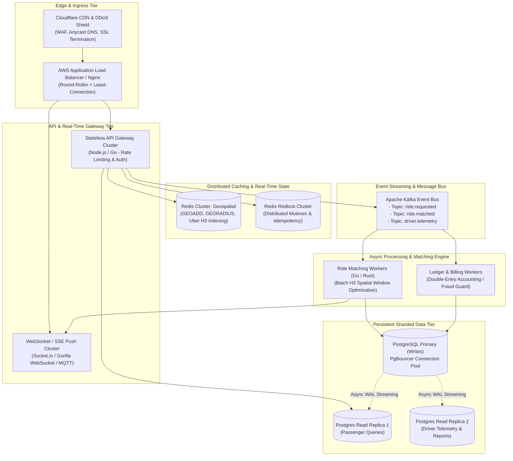

# Module 09: Scale Bonus — "If Oi Tesla Goes Viral" (1M Passengers & 100k Drivers)

**Project:** Dhaka Tesla Pool  
**Author:** Software Architect & Principal Distributed Systems Engineer  
**Focus:** Scaling Blueprint from Single-Node MVP to High-Throughput Distributed Platform  

---

## 1. High-Scale Distributed Architecture Diagram



---

## 2. Deep-Dive Scaling Vector Breakdown

### 1. Geospatial Indexing & Driver Tracking at Scale (100k Drivers)
- **The Bottleneck:** Writing 100,000 GPS coordinate pings per second directly into a relational database creates immediate disk I/O exhaustion.
- **The Scaled Solution:**
  - Offload live driver coordinate pings to a **Redis Geospatial cluster** using Uber's **H3 Hexagonal Hierarchical Spatial Index** (Resolution 8 $\approx$ 460m diameter hexagons).
  - Vehicles periodically execute `GEOADD drivers:dhaka <lng> <lat> <driver_id>`.
  - When Nusrat requests a ride at Banani Road 11, the matching engine queries only Jashim and other drivers situated within H3 cell index `8865604433fffff` using `GEORADIUSBYMEMBER` in $< 3\text{ms}$.
  - Relational database only stores historical route trails at 30-second throttled intervals.

### 2. High-Concurrency Ride Matching (DB Contention Elimination)
- **The Bottleneck:** At 1,000 booking requests per second, database row locks (`SELECT FOR UPDATE`) on pools cause connection pool exhaustion and transaction lock queues.
- **The Scaled Solution:**
  - **Spatial Batching Window:** Instead of continuous ad-hoc matching, incoming ride requests are buffered in a **3-second sliding window** partitioned by H3 geospatial cell.
  - An asynchronous Matching Worker (written in Go/Rust) pulls the batch, computes optimal multi-passenger pairings (solving a graph bipartite matching problem), and writes the allocations in single bulk transactions.
  - If a driver's pool has 1 seat left, Redis `DECRBY pool:{id}:available_seats 1` acts as a sub-millisecond atomic memory gate before falling back to the database transaction.

### 3. Database Sharding & Read/Write Splitting
- **Connection Pooling:** **PgBouncer** sits in front of PostgreSQL to handle up to 20,000 open client connections, multiplexing them over 200 persistent database backend connections.
- **Read-Write Separation:**
  - All write mutations (ride creation, state transitions, ledger debits) target the PostgreSQL Primary.
  - High-frequency read queries (passenger polling trip status, history views, driver profile lookups) target **Read Replicas** via WAL streaming replication.
- **Horizontal Sharding:** When trip records exceed 50 million rows, partition tables by `created_at` (monthly range partitioning) and shard `ride_requests` by `city_id` (Dhaka, Chittagong, Sylhet).

### 4. Real-Time Telemetry: WebSockets / Server-Sent Events (SSE)
- Replace HTTP polling with **Server-Sent Events (SSE)** for passengers (unidirectional status updates) and a **WebSocket cluster** for drivers (bidirectional telemetry).
- A **Redis Pub/Sub** or **Kafka** backplane allows WebSocket gateways to scale horizontally across multiple instances without sticky sessions.

### 5. Idempotency & Network Resilience
- Every critical API call requires a unique UUID `Idempotency-Key` stored in Redis with an 86,400-second (24h) TTL:
  ```
  SET idempotency:{key} {response_payload} NX EX 86400
  ```
- If a mobile client retries due to a network timeout, the gateway returns the cached response instantly without re-processing business logic or double-charging wallets.

### 6. Observability & Telemetry (OpenTelemetry + Prometheus + Grafana)
- **Golden Signals Monitored:**
  - **Latency:** p50, p95, p99 on ride match endpoints (target: $< 200\text{ms}$).
  - **Traffic:** Requests per second (RPS) per H3 zone.
  - **Errors:** Rate of HTTP 5xx responses and 409 Conflict spikes.
  - **Saturation:** PgBouncer connection pool usage and Redis memory headroom.
- Distributed tracing using **OpenTelemetry** traces a request across Gateway $\rightarrow$ Kafka $\rightarrow$ Matching Worker $\rightarrow$ Postgres.

### 7. Zero-Downtime Deployment: Canary & Blue-Green
- Stateless API instances deployed via **Kubernetes (EKS / GKE)** with Horizontal Pod Autoscaling (HPA) scaling on CPU and Kafka lag metrics.
- Database schema changes follow the **Expand/Contract Pattern**:
  1. Add column as nullable.
  2. Deploy application reading both / writing new.
  3. Backfill historical records asynchronously.
  4. Add `NOT NULL` constraint and drop obsolete columns.
