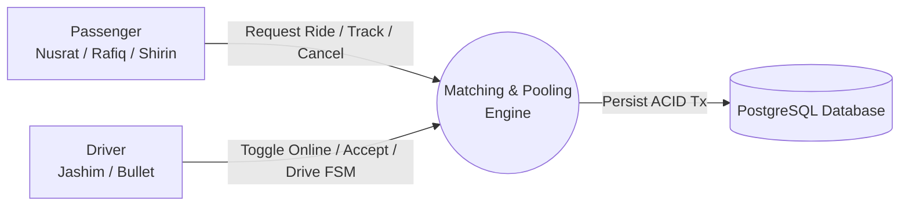

# Dhaka Tesla Pool: PRD MVP Requirements, Roles, Security & Workflow Specification

> **Project:** Dhaka Tesla Pool (*Share a seat. Split the fare. Survive Dhaka traffic.*)  
> **Document Type:** Core Product & Architectural MVP Specification  
> **Audience:** Engineering Evaluators, Product Stakeholders, and Core Developers  

---

## 1. Executive Summary & The Problem Context

### 1.1 The Banani Rush-Hour Story
At **8:41 AM on Banani Road 11**, **Jashim** waits beside **Bullet**, his electric 3-wheeler auto-rickshaw ("Dhaka Tesla"). 
* **Nusrat** (Passenger 1), running late, requests a ride to Mohakhali.
* Two minutes later (8:43 AM), **Rafiq** (Passenger 2) requests a ride along the same route to Gulshan 1.
* In less than a second, the platform must determine if they can share Bullet, calculate transparent individual fares with split discounts, and update Jashim's dispatch manifest.
* Thirty seconds later, **Shirin** (Passenger 3) attempts to claim the remaining seat under heavy concurrent contention.

### 1.2 Core MVP Goal
To build a production-grade ride-pooling MVP that delivers:
1. **Sub-second route and zone matching** without external paid map APIs.
2. **Deterministic fare splitting** calculated strictly in integer poysha.
3. **Guaranteed physical capacity enforcement** — Bullet has strictly 3 seats; overbooking under race conditions is mathematically prohibited.
4. **Zero-trust tenant privacy** — passengers cannot view each other's fares, personal information, or trip history.

---

## 2. Actors & Role Responsibilities

The PRD structures the MVP strictly around three core actors:



### 2.1 Passenger (`ROLE_PASSENGER`)
* **Identity / Personas:** Nusrat, Rafiq, Shirin.
* **Authentication:** Registration and login via email/password; receives a signed JWT token with passenger claims.
* **Ride Request:** Selects pickup zone, destination zone, and seats requested (1 to 3).
* **Fare Transparency:** Views estimated individual solo fare and dynamic pooled discount fare. Nusrat never sees Rafiq’s fare or details.
* **Live Trip Tracking:** Real-time lifecycle status tracking (`REQUESTED` $\rightarrow$ `MATCHED` $\rightarrow$ `DRIVER_ARRIVED` $\rightarrow$ `STARTED` $\rightarrow$ `COMPLETED`).
* **Trip Management & Cancellation:** Can cancel an active request before the trip enters `STARTED` state. Cancelled seats are immediately restored to the pool.
* **Trip History:** Accesses personal past rides, receipts, and simulated wallet balance.

### 2.2 Driver (`ROLE_DRIVER`)
* **Identity / Personas:** Jashim (driving "Bullet", license: `DHAKA-METRO-HA-11-2049`).
* **Availability Toggle:** Can switch between **Online** (available to receive dispatches) and **Offline** (dispatch paused).
* **Vehicle Assignment:** Fixed physical capacity of **3 seats**.
* **Dispatch Telemetry HUD:**
  * Sees active pool manifest: total occupied seats, remaining seats.
  * Sees passenger list (first names, pickup zones, destination zones, and seat counts).
  * Excludes passenger personal wallet balances and private history.
* **Lifecycle Progression:** Controls the physical progression of the trip:
  1. `DRIVER_ARRIVED`: Notifies passengers that Bullet has arrived at Banani Road 11.
  2. `STARTED`: Verifies passenger boarding and starts the trip (locks out passenger cancellations).
  3. `COMPLETED`: Marks destination drop-offs, triggers wallet settlement, and frees vehicle seats.
* **Earnings & History:** Views completed trips and earnings ledger.

### 2.3 System Orchestrator / Matching Engine
* Evaluates geographical zone compatibility and direction vectors in $<1$ second.
* Enforces atomic seat reservations within database transactions.
* Dynamically recalculates individual passenger fares whenever a co-passenger joins or leaves the pool.

---

## 3. Security, Authentication & Login Systems

### 3.1 Authentication & Session Management
* **Token-Based Auth (JWT):** Stateless authentication using JSON Web Tokens signed with HMAC-SHA256 (`HS256`).
* **Payload Claims:**
  ```json
  {
    "sub": "usr_nusrat_001",
    "role": "PASSENGER",
    "name": "Nusrat Jahan",
    "iat": 1727361600,
    "exp": 1727448000
  }
  ```
* **Credential Protection:** Passwords securely hashed with `bcrypt` (work factor 10). Zero plaintext storage.
* **Role-Based Access Control (RBAC):** Middleware intercepts requests to restrict endpoints (e.g., driver dispatch actions cannot be called by passengers).

### 3.2 Zero-Trust Passenger Isolation (Anti-IDOR)
* **The Privacy Rule:** Nusrat and Rafiq share the same physical vehicle, but their digital footprint must remain strictly isolated.
* **Data Masking:**
  * Passenger A cannot query Passenger B’s fare, phone number, address, or wallet balance.
  * In `/api/rides/:id`, the server verifies `req.user.sub === ride.passenger_id`. Unauthorized cross-queries return `403 Forbidden`.
* **Sanitized Pool Manifest:** When a passenger views their active ride, the co-passenger manifest only reveals that a co-passenger exists (e.g., `is_shared: true`, `co_passengers_count: 1`), redacting names and financial details.

### 3.3 Concurrency Control & The Last-Seat Race Solution
* **The Threat:** Bullet has 1 seat remaining. Nusrat and Shirin submit booking requests at the exact same millisecond ($t_0$ and $t_0 + 5\text{ms}$). Under naive implementations, both threads read `seats_available = 1` and book, resulting in 4 passengers in a 3-seat vehicle.
* **The Architecture Defense:**
  1. **Pessimistic Row Locking:** The matching engine opens an isolated database transaction and executes:
     ```sql
     SELECT * FROM pools WHERE id = :poolId FOR UPDATE;
     ```
  2. **Atomic Verification:** The thread holding the lock checks `(occupied_seats + requested_seats) <= 3`.
  3. **First-Come Resolution:** Thread 1 (Shirin) commits, incrementing `occupied_seats` to 3.
  4. **Deterministic Conflict Rejection:** Thread 2 resumes, sees 0 available seats, rolls back, and returns `409 Conflict` ("Seat no longer available").
  5. **Database Constraint Safety Net:** A database check constraint enforces the rule at the engine level:
     ```sql
     ALTER TABLE pools ADD CONSTRAINT chk_bullet_capacity CHECK (occupied_seats <= 3);
     ```

### 3.4 Network Resilience & Idempotency
* Dhaka’s 2G/3G mobile networks often drop packets during cell tower handovers.
* Clients attach a unique `Idempotency-Key` UUID header to booking requests. If network lag triggers duplicate retries, the server returns the cached response rather than creating duplicate rides or debiting twice.

---

## 4. Geography, Routing & Fare Architecture

### 4.1 Simplified Geography (No Paid Maps)
* In accordance with PRD Section 4, external paid APIs (e.g., Google Maps) are excluded.
* A predefined network of Dhaka hub zones with pre-calculated distance matrices is utilized:
  * **Hubs:** Banani, Gulshan 1, Gulshan 2, Mohakhali, Dhanmondi, Mirpur, Uttara, Farmgate, Bashundhara.
* **Matching Rule:** Compatible pickup origin (e.g., Banani) + compatible directional vector (e.g., Mohakhali and Gulshan 1 both head southward from Banani).

### 4.2 Deterministic Fare Model
Fares are testable by hand and follow this exact formula:

$$\text{passengerFare} = \text{baseFare} + (\text{distanceKm} \times \text{ratePerKm}) - \text{poolDiscount}$$

* **Default Baseline Parameters:**
  * Base Fare: **৳30.00**
  * Per-Kilometer Rate: **৳15.00 / km**
  * Pool Discount: **25% off** total trip fare when sharing the vehicle.

* **Nusrat's Trip (Banani $\rightarrow$ Mohakhali, 3.0 km):**
  * Solo Fare: $30 + (3.0 \times 15) = ৳75.00$
  * Pooled Fare: $75.00 - (75.00 \times 0.25) = \mathbf{৳56.25}$ (5,625 poysha)

* **Rafiq's Trip (Banani $\rightarrow$ Gulshan 1, 2.5 km):**
  * Solo Fare: $30 + (2.5 \times 15) = ৳67.50$
  * Pooled Fare: $67.50 - (67.50 \times 0.25) = \mathbf{৳50.63}$ (5,063 poysha)

### 4.3 Integer Currency Representation
* Currency is stored as **64-bit integer Poysha** (`৳1.00 = 100 poysha`).
* **Why:** Prevents IEEE-754 floating-point rounding discrepancies (e.g., `0.1 + 0.2 = 0.30000000000000004`), ensuring financial ledgers balance to the exact cent.
* **Payment Mode:** Simulated cash or in-app **TeslaPay** wallet ledger with debit holds and final capture on trip completion.

---

## 5. End-to-End Working Flow & Lifecycle

### 5.1 Finite State Machine (FSM)
The system transitions strictly along valid states:

$$\mathbf{REQUESTED \longrightarrow MATCHED \longrightarrow DRIVER\_ARRIVED \longrightarrow STARTED \longrightarrow COMPLETED}$$
$$\mathbf{(\text{Any state prior to } STARTED \longrightarrow CANCELLED)}$$

| State | Permitted Initiator | Description | Invariant & Side Effect |
|---|---|---|---|
| `REQUESTED` | Passenger | Ride submitted with pickup, drop-off, and requested seats. | Ride record created; initial solo estimate calculated. |
| `MATCHED` | Engine / System | Ride paired into Jashim's Bullet pool. | Available seats decremented atomically; pool discount applied to all members. |
| `DRIVER_ARRIVED` | Driver (Jashim) | Jashim reaches Banani Road 11 pickup point. | Passengers receive real-time notification to board. |
| `STARTED` | Driver (Jashim) | Passengers boarded; trip commences. | **Passenger cancellations locked out**; trip timer starts. |
| `COMPLETED` | Driver (Jashim) | Passengers safely dropped off at destinations. | Wallets settled; driver balance credited; seats returned to pool. |
| `CANCELLED` | Passenger | Ride cancelled before driver initiates `STARTED`. | Allocated seats restored immediately to Bullet; remaining passenger fares updated. |

### 5.2 Step-by-Step Scenario Execution

```mermaid
sequenceDiagram
    autonumber
    actor Nusrat as Nusrat (Passenger 1)
    actor Rafiq as Rafiq (Passenger 2)
    actor Jashim as Jashim (Driver)
    participant App as API & Pooling Engine
    participant DB as Relational Database

    Note over Jashim,DB: 8:41 AM — Jashim toggles Online on Banani Rd 11
    Jashim->>App: POST /api/driver/status (ONLINE, Bullet: 3 seats free)
    App->>DB: UPDATE vehicles SET is_online = true

    Note over Nusrat,DB: 8:41 AM — Nusrat books to Mohakhali
    Nusrat->>App: POST /api/rides/request (Banani -> Mohakhali, 1 seat)
    App->>DB: Lock pool & check capacity (0 + 1 <= 3) -> OK
    App->>DB: INSERT ride_request (Status: MATCHED, Solo: ৳75.00)
    App-->>Nusrat: 200 OK (Matched with Bullet)
    App-->>Jashim: Manifest update: 1 passenger (Nusrat)

    Note over Rafiq,DB: 8:43 AM — Rafiq books to Gulshan 1
    Rafiq->>App: POST /api/rides/request (Banani -> Gulshan 1, 1 seat)
    App->>DB: Evaluate spatial match (Banani pickup + Southbound route)
    App->>DB: Lock pool & check capacity (1 + 1 <= 3) -> OK
    App->>DB: Pool Rafiq into Bullet; Apply 25% pool discount to both
    App-->>Rafiq: 200 OK (Matched, Fare: ৳50.63)
    App-->>Nusrat: Push update: "Discount applied! New fare: ৳56.25"
    App-->>Jashim: Manifest update: 2 passengers (Nusrat + Rafiq)

    Note over Jashim,DB: 8:44 AM — Physical pickup & ride progression
    Jashim->>App: POST /api/driver/arrived
    App-->>Nusrat: Status: DRIVER_ARRIVED
    App-->>Rafiq: Status: DRIVER_ARRIVED

    Jashim->>App: POST /api/driver/start
    App->>DB: UPDATE rides SET status = STARTED (Cancellation disabled)

    Note over Jashim,DB: 8:54 AM — Drop-off & settlement
    Jashim->>App: POST /api/driver/complete
    App->>DB: Settle integer poysha ledger, reset Bullet seats to 3 free
    App-->>Nusrat: Status: COMPLETED, Receipt: ৳56.25 debited
    App-->>Rafiq: Status: COMPLETED, Receipt: ৳50.63 debited
    App-->>Jashim: Status: COMPLETED, Driver Wallet: +৳106.88 credited
```

---

## 6. Technical Stack & Deliverable Standards

| Component | Selected Stack | Evaluator Verification Criterion |
|---|---|---|
| **Frontend** | Next.js 14 (App Router, TypeScript) | Dual-cockpit (Passenger & Driver views), 90 FPS performance, clean empty/loading/error states. |
| **Backend** | Node.js (TypeScript, Fastify / Express) | Clean modular REST API, validation guards, deterministic business logic. |
| **Database** | Relational Database (PostgreSQL / SQLite) | ACID transactions, foreign keys, `CHECK (occupied_seats <= 3)`, big integer poysha. |
| **DevOps** | Docker & Docker Compose | Single-command launch: `docker compose up --build -d` runs DB, backend, frontend, migrations, and seed data. |
| **Seed Data** | Canonical Story Cast | Pre-populated with **Jashim, Bullet, Nusrat, Rafiq, Shirin** (Zero generic `user1/driver1`). |
| **Git Standards** | Long-Lived Branches & Semantic Commits | `master`, `pre-release`, `release/v1.0.0` with feature branches (`feature/*`) and conventional commit history (`feat(...)`, `fix(...)`). |
| **Automated Tests** | Integration Invariant Tests | Vitest/Jest suite verifying capacity limits, FSM invalid transitions, tenant data isolation, and concurrent last-seat races. |
| **Video Deliverable**| 6-Minute Loom Walkthrough | Structured breakdown: 0-1m Problem, 1-3m Architecture & ERD, 3-6m Live demo & edge cases. |

---

## 7. Explicit Anti-Patterns Avoided (PRD §16)

* ❌ **No Paid APIs or Infrastructure:** Zero dependencies on paid Google Maps, cloud Redis, or proprietary SaaS.
* ❌ **No Committed Secrets:** Environment variables handled strictly via `.env.example`.
* ❌ **No Giant Monolithic Commits:** Documented incremental git journey across feature branches.
* ❌ **No Architectural Complexity Bloat:** Microservices, Kafka, and Kubernetes deliberately excluded from the MVP baseline.
* ❌ **No Generic Placeholders:** Story cast maintained end-to-end across database seeds, tests, UI manifests, and documentation.
